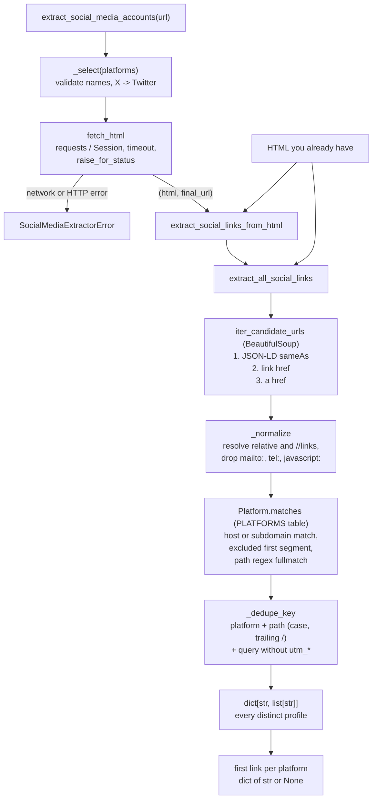

<div align="center">

# socialmediaextractor

**Find a website's social media profiles in one call, without picking up share buttons.**

[](https://pypi.org/project/socialmediaextractor/)
[](https://pypi.org/project/socialmediaextractor/)
[](https://pepy.tech/projects/socialmediaextractor)
[](https://github.com/irfanalidv/socialmediaextractor/actions/workflows/tests.yml)
[](https://github.com/irfanalidv/socialmediaextractor/actions/workflows/codeql.yml)
[](https://github.com/irfanalidv/socialmediaextractor/blob/main/LICENSE)
[](https://github.com/astral-sh/ruff)
[](https://mypy-lang.org/)
[](https://github.com/irfanalidv/socialmediaextractor/blob/main/CONTRIBUTING.md)

</div>

`socialmediaextractor` fetches a web page (or takes HTML you already have) and returns the
organization's profile links on **X/Twitter, LinkedIn, Instagram, Facebook, YouTube, TikTok,
GitHub, Threads and Bluesky**.

## Why

A plain "does the link contain `twitter.com`?" check also matches share buttons
(`twitter.com/intent/tweet`), single posts, embeds and look-alike domains. This library uses
explicit per-platform URL rules instead, reads the identity declarations sites make on purpose
(JSON-LD `sameAs`, `rel="me"`), and collapses different spellings of the same account, so you get
one clean profile URL per network.

## Features

| | |
| --- | --- |
| **9 platforms** | Facebook, LinkedIn, Twitter (`twitter.com` and `x.com`, alias `X`), Instagram, YouTube, TikTok, GitHub, Threads, Bluesky |
| **Three link sources** | JSON-LD `sameAs`, `<link href>` (for example `rel="me"`), and `<a href>`, in that priority order |
| **Profile-only rules** | Skips share/intent/dialog URLs, posts, reels, videos, GitHub issue pages, site-navigation pages and look-alike hosts |
| **Deduplication** | `x.com/Acme`, `twitter.com/acme/` and `www.x.com/acme?utm_source=...` count as one account |
| **URL resolution** | Relative and protocol-relative (`//facebook.com/...`) links are resolved against the page URL |
| **Bring your own HTML** | Every extractor works on an HTML string, so it fits into existing crawlers |
| **Robust fetching** | Timeout on every request, optional `requests.Session`, one clear `SocialMediaExtractorError` |
| **CLI and typing** | `socialmediaextractor` command with JSON output; ships `py.typed`, checked with mypy |

## Install

```bash
pip install socialmediaextractor
# or
uv pip install socialmediaextractor
```

Requires Python 3.10 to 3.13. Dependencies: `requests` and `beautifulsoup4`. No extras.

## Quickstart

Offline, on HTML you already have:

```python
from socialmediaextractor import classify_url, extract_all_social_links, extract_social_links_from_html

html = """
<script type="application/ld+json">{"@type": "Organization",
  "sameAs": ["https://www.linkedin.com/company/acme-corp"]}</script>
<a href="https://twitter.com/intent/tweet?text=hi">Share on X</a>
<a href="https://x.com/acmecorp">Follow us</a>
<a href="https://twitter.com/AcmeCorp/">Old link, same account</a>
<a href="//github.com/acme-corp">GitHub</a>
"""

print(extract_social_links_from_html(html, "https://acme.example/", platforms=["X", "LinkedIn", "GitHub"]))
# {'Twitter': 'https://x.com/acmecorp', 'LinkedIn': 'https://www.linkedin.com/company/acme-corp', 'GitHub': 'https://github.com/acme-corp'}

print(extract_all_social_links(html, platforms=["X"]))
# {'Twitter': ['https://x.com/acmecorp']}

print(classify_url("https://twitter.com/intent/tweet?text=hi"))  # None
```

Fetching a live site (needs network access):

```python
from socialmediaextractor import extract_social_media_accounts

print(extract_social_media_accounts("https://www.djangoproject.com"))
```

Output (run on 2026-10-31; live sites change):

```python
{'Facebook': None,
 'LinkedIn': 'https://www.linkedin.com/company/django-software-foundation',
 'Twitter': 'https://x.com/djangoproject',
 'Instagram': None,
 'YouTube': None,
 'TikTok': None,
 'GitHub': 'https://github.com/django/django',
 'Threads': None,
 'Bluesky': 'https://bsky.app/profile/djangoproject.com'}
```

Every requested platform key is always present; platforms with no link are `None`.

### Command line

```bash
socialmediaextractor https://www.python.org
socialmediaextractor https://www.mozilla.org --all -p Bluesky -p Instagram
socialmediaextractor site-a.com site-b.com      # several URLs -> one JSON object keyed by URL
```

The command prints JSON to stdout. It exits with `1` if any URL fails to fetch and `2` for
invalid arguments (for example an unknown `--platform`).

## How it works



Key design decisions:

- **Declarative rules.** Each network is a frozen `Platform(name, hosts, path, exclude_first_segment)`
  in `PLATFORMS`. A URL is a profile only if its host is (a subdomain of) a listed host, its first
  path segment is not reserved (`intent`, `sharer`, `login`, ...), and its whole path matches the
  profile regex. Adding a network is a data change plus fixtures.
- **Order is meaning.** Candidates are yielded JSON-LD first, then `<link>`, then `<a>`, so the
  "first link" is the one the site declared most deliberately.
- **Fail loudly on fetch, quietly on content.** Network and HTTP errors raise
  `SocialMediaExtractorError`; broken or pathologically nested JSON-LD blocks are skipped (logged
  at `DEBUG` on the `socialmediaextractor.extractor` logger) so one bad block cannot abort a page.
- **No hidden state.** No caching, globals or retries; pass your own `requests.Session` for
  connection reuse, proxies or retry adapters.

## Use cases and recipes

All examples run offline: bundled sample pages are served through a fake session.

| Script | What it shows |
| --- | --- |
| [`examples/quickstart.py`](https://github.com/irfanalidv/socialmediaextractor/blob/main/examples/quickstart.py) | First link per platform and all links from a saved page; share buttons skipped |
| [`examples/enrich_leads_csv.py`](https://github.com/irfanalidv/socialmediaextractor/blob/main/examples/enrich_leads_csv.py) | Add LinkedIn / X / Facebook / Instagram columns to a CSV of company websites (`--live` to fetch real sites) |
| [`examples/audit_brand_links.py`](https://github.com/irfanalidv/socialmediaextractor/blob/main/examples/audit_brand_links.py) | Audit a site for missing networks, multiple accounts and legacy `twitter.com` links |
| [`examples/classify_url_list.py`](https://github.com/irfanalidv/socialmediaextractor/blob/main/examples/classify_url_list.py) | Label a list of URLs (backlinks, CRM fields) as profiles or not, without fetching |

## Configuration

There are no environment variables. Options are function arguments:

| Option | Applies to | Default | Effect |
| --- | --- | --- | --- |
| `platforms` | all extractors | all 9 | Restrict and order the result; case-insensitive; `X` is an alias for `Twitter`; unknown names raise `ValueError` |
| `base_url` | HTML extractors | `None` | Resolve relative links against this URL (fetching uses the final URL after redirects) |
| `timeout` | `fetch_html`, `extract_social_media_accounts`, CLI `--timeout` | `15.0` s | Request timeout |
| `session` | `fetch_html`, `extract_social_media_accounts` | `None` | A `requests.Session` to reuse (proxies, retries, cookies) |
| `--all` | CLI | off | Print every distinct link per platform instead of the first |

Requests send the headers in `socialmediaextractor.extractor.DEFAULT_HEADERS` (a descriptive
`User-Agent` and `Accept: text/html`).

## API overview

| Name | Returns |
| --- | --- |
| `extract_social_media_accounts(url, *, platforms=None, timeout=15.0, session=None)` | Fetches `url`; `dict[str, str \| None]`, first profile link per platform |
| `extract_social_links_from_html(html, base_url=None, *, platforms=None)` | Same, from an HTML string |
| `extract_all_social_links(html, base_url=None, *, platforms=None)` | `dict[str, list[str]]`, every distinct profile link in page order |
| `classify_url(url)` | Platform name, or `None` if the URL is not a profile |
| `iter_candidate_urls(html, base_url=None)` | Iterator over all absolute http(s) URLs in a page, in priority order |
| `fetch_html(url, *, timeout=15.0, session=None)` | `(html, final_url)`; raises `SocialMediaExtractorError` |
| `PLATFORMS`, `Platform` | The matching rules (name, hosts, path regex, excluded segments) |
| `SocialMediaExtractorError` | Raised when a page cannot be fetched (subclass of `RuntimeError`) |

<details>
<summary>Upgrading from 0.x</summary>

- `from socialmediaextractor import extract_social_media_accounts` works again. The 0.2 to 0.4
  wheels on PyPI shipped without any Python code, so the import failed.
- The `Facebook`, `LinkedIn` and `Twitter` keys are unchanged. Six new platform keys were added,
  and `Twitter` now also matches `x.com`.
- Share buttons and other non-profile links are no longer returned.
- Network and HTTP errors now raise `SocialMediaExtractorError`. Before, an error page was
  silently parsed.

</details>

## References

The link sources follow these specifications:

- [schema.org `sameAs`](https://schema.org/sameAs) property, embedded as
  [JSON-LD 1.1](https://www.w3.org/TR/json-ld11/) (W3C Recommendation, 2020).
- [`rel="me"`](https://microformats.org/wiki/rel-me) (microformats), used for identity
  consolidation and profile verification.

## Limitations

- Only the HTML returned by the server is parsed; links injected by JavaScript are not seen.
  Pass the rendered HTML from a headless browser to the `*_from_html` functions if you need them.
- Rules match URL shapes, not account existence: a matched URL may point to a deleted account.
- The rules cover the URL formats in the test suite; platforms change their URL schemes over time.

## Roadmap

- More networks (for example Mastodon, Pinterest, Reddit, Discord invite links).
- Optional crawl of a site's contact/about page when the home page has no profiles.
- Async fetching for large batches.

## Contributing, security, citation, license

- Contributions are welcome: see [CONTRIBUTING.md](https://github.com/irfanalidv/socialmediaextractor/blob/main/CONTRIBUTING.md) and the [Code of Conduct](https://github.com/irfanalidv/socialmediaextractor/blob/main/CODE_OF_CONDUCT.md). To add a platform, add a `Platform` entry in `socialmediaextractor/extractor.py` with fixture cases.
- Report vulnerabilities as described in [SECURITY.md](https://github.com/irfanalidv/socialmediaextractor/blob/main/SECURITY.md).
- Release notes: [CHANGELOG.md](https://github.com/irfanalidv/socialmediaextractor/blob/main/CHANGELOG.md).
- If you use this in research, please cite it using [CITATION.cff](https://github.com/irfanalidv/socialmediaextractor/blob/main/CITATION.cff).
- MIT licensed: see [LICENSE](https://github.com/irfanalidv/socialmediaextractor/blob/main/LICENSE).

<details>
<summary>Development setup</summary>

```bash
git clone https://github.com/irfanalidv/socialmediaextractor.git
cd socialmediaextractor
uv venv && uv pip install -e ".[dev]"
pre-commit install
ruff check . && ruff format --check .
mypy socialmediaextractor
pytest --cov=socialmediaextractor
```

The tests run offline against saved HTML fixtures in `tests/fixtures/`.

</details>
